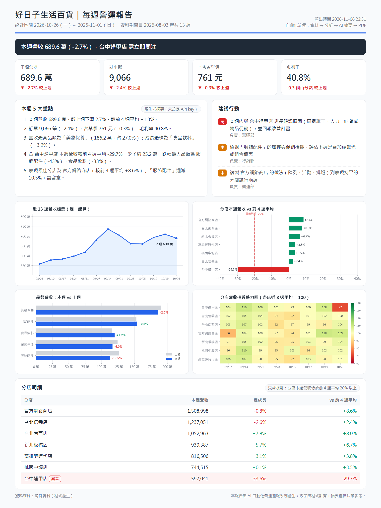
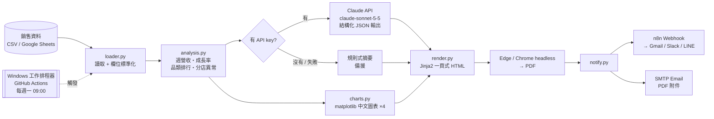
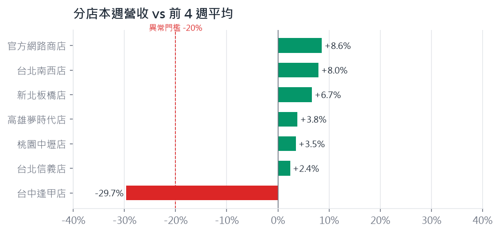

# AI 自動化營運週報 Auto Weekly Report

> 每週一早上，主管信箱自動收到一份「看得懂、能決策」的營運週報 PDF。
> 從撈資料、算指標、畫圖、寫重點到寄出，全部一鍵完成，**手動 3 小時 → 自動 3 秒**。



📄 範例輸出：[docs/sample_report.pdf](docs/sample_report.pdf)（一頁 A4）

---

## 解決什麼問題

在零售 / 電商公司，「每週營運週報」幾乎是每個營運、企劃或 PM 的固定工作。傳統做法通常是：

| 步驟 | 手動做法 | 每週耗時（估） |
|---|---|---|
| 1. 撈資料 | 從 POS、電商後台、Google Sheets 各自匯出再合併 | 20 分鐘 |
| 2. 算指標 | Excel 樞紐分析：週營收、成長率、品類排行、分店比較 | 60 分鐘 |
| 3. 做圖表 | 複製到簡報、調格式、對齊 | 40 分鐘 |
| 4. 寫重點 | 看數字找異常，寫給主管的摘要與建議 | 40 分鐘 |
| 5. 排版寄送 | 轉 PDF、寫信、寄給主管群組 | 20 分鐘 |
| **合計** | | **約 3 小時 / 週，一年約 150 小時** |

痛點不只是花時間，還有：

- **異常容易漏看**：七家分店 × 五個品類，某間店掉了三成，埋在表格裡不一定看得到。
- **品質看當週狀況**：忙的時候週報就變成「貼數字」，沒有洞察。
- **格式每週不一樣**：主管每次都要重新找重點在哪。

### 這個工具怎麼解決

| 痛點 | 做法 |
|---|---|
| 撈資料費時 | 直接讀 CSV 或 **Google Sheets 網址**，中英文欄位名稱自動對應 |
| 指標計算 | pandas 固定邏輯計算，數字每週一致、可追溯 |
| 異常漏看 | 自動比對「本週 vs 前 4 週平均」，低於 -20% 標紅並拆解是哪個品類掉 |
| 寫重點 | **Claude API** 根據算好的數字寫 5 點重點 + 3 項行動（指定負責單位與優先度）|
| 排版寄送 | 固定版型 HTML → PDF，透過 **n8n Webhook / Email** 自動寄出 |
| 每週要記得做 | **Windows 工作排程器 / GitHub Actions** 每週一 09:00 自動執行 |

**結果：產出一份週報從約 3 小時降到 3 秒（本機實測 2.7 秒），一年省下約 150 小時**，
營運人員把時間花在「追問異常原因、執行改善」，而不是做報表。

> 設計原則：**數字由程式算，文字由 AI 寫。** AI 只拿到計算好的指標 JSON，不碰原始資料，
> 避免模型自己算錯數字，也大幅降低 token 成本。沒有 API key 時自動改用規則式摘要，流程照樣跑完。

---

## 系統架構



---

## 快速開始

需求：Python 3.10+、Windows 內建的 Microsoft Edge（或 Chrome）。

```bash
git clone <this-repo> auto-report
cd auto-report
python -m venv .venv
.venv\Scripts\activate          # macOS / Linux: source .venv/bin/activate
pip install -r requirements.txt
python run_report.py
```

輸出在 `output/`：

```
[1/5] 讀取資料：3,185 列，2026-08-03 ~ 2026-11-01
[2/5] 分析完成：本週 2026-10-26 ~ 2026-11-01，異常分店 1 間
[3/5] 圖表 4 張 → output\charts
[4/5] 摘要來源：規則式摘要（未設定 API key）
[5/5] HTML → output\weekly_report_2026-10-26.html
      PDF  → output\weekly_report_2026-10-26.pdf（msedge）
完成，耗時 2.7 秒
```

**不需要任何 API key 就能跑完。** 要啟用 AI 摘要，把 `.env.example` 複製成 `.env` 並填入 `ANTHROPIC_API_KEY`。

### 常用參數

| 指令 | 說明 |
|---|---|
| `python run_report.py` | 用範例資料產出報告 |
| `python run_report.py --input data/my.csv` | 用自己的 CSV |
| `python run_report.py --input "https://docs.google.com/spreadsheets/d/<ID>/edit#gid=0"` | 直接讀 Google Sheets（需設為「知道連結者可檢視」）|
| `python run_report.py --regen-sample` | 重新產生範例資料，讓「本週」= 最近一個完整週 |
| `python run_report.py --no-ai` | 強制使用規則式摘要 |
| `python run_report.py --send` | 產出後透過 n8n / Email 寄出 |
| `python run_report.py --company "我的公司"` | 修改報告抬頭 |

---

## 資料格式

每列 = 某天 × 某分店 × 某品類的彙總。只有 4 個欄位是必要的，欄位名稱中英文都可以：

| 內部欄位 | 可接受的欄位名稱 | 必要 |
|---|---|---|
| date | 日期、date、order_date | ✅ |
| store | 分店、門市、store、branch | ✅ |
| category | 品類、類別、category | ✅ |
| revenue | 營收、銷售額、revenue、sales（可含 `$`、千分位逗號）| ✅ |
| orders | 訂單數、orders | |
| units | 銷售數量、units、qty | |
| gross_profit | 毛利、gross_profit | |
| region / channel | 區域 / 通路 | |

範例資料由 [`report/data_gen.py`](report/data_gen.py) 產生：7 間分店（含官方網路商店）、5 個品類、13 週，
並刻意埋入真實情境：週末客流、中秋禮盒旺季、線上美妝成長，以及**最新一週台中逢甲店營收驟降約 30%**，
用來驗證異常偵測與 AI 摘要是否抓得到。

---

## 分析內容

| 指標 | 計算方式 |
|---|---|
| 週營收 / 訂單 / 客單價 / 毛利率 | 以週一為一週起點，只取完整週，與上週比較 |
| 近 13 週趨勢 | 每週總營收折線圖 |
| 品類排行 | 本週 vs 上週營收、占比、成長率 |
| 分店異常 | 本週營收 vs **前 4 週平均**（比只看上週更不易被單週波動誤導），低於 -20% 判定異常，並拆解跌幅最大的品類 |
| 分店熱力圖 | 各店近 8 週營收指數（自身平均 = 100），大小店可以放在一起比較 |



---

## AI 摘要

- 模型：`claude-sonnet-5-5`（可用環境變數 `CLAUDE_MODEL` 更換）
- 使用 **結構化輸出（JSON Schema）**，保證拿到固定格式：一句話總結、5 點重點、3 項行動（含負責單位與優先度）
- System prompt 定義讀者是「只花 30 秒看的主管」：繁體中文、金額用萬、只能用提供的數字、原因不確定要說「可能」
- 啟用伺服器端備援（server-side fallback），主模型拒答時自動改用其他模型
- 任何錯誤（沒 key、網路、額度）都會退回 **規則式摘要**，週報不會因為 AI 失敗而中斷；報告右上角會標示摘要來源

---

## 自動寄送

在 `.env` 設定後加上 `--send`：

**n8n Webhook**：設定 `N8N_WEBHOOK_URL`。程式會 POST 一個 JSON：

```json
{
  "subject": "【好日子生活百貨營運週報】2026-10-26 ~ 2026-11-01",
  "text": "本週營收 689.6 萬（-2.7%）…（純文字摘要，可直接當訊息內容）",
  "kpi": { "revenue": 6896461, "revenue_wow": -0.027, "...": "..." },
  "summary": { "headline": "...", "highlights": ["..."], "actions": [{"action": "...", "owner": "營運部", "priority": "高"}] },
  "anomalies": [{ "store": "台中逢甲店", "vs_base": -0.297, "...": "..." }],
  "pdf_filename": "weekly_report_2026-10-26.pdf",
  "pdf_base64": "JVBERi0xLjQK..."
}
```

n8n 流程建議：`Webhook` →（`Convert to File` 把 `pdf_base64` 轉成檔案）→ `Gmail` / `Slack` / `LINE` 節點。

**Email**：設定 `SMTP_HOST`、`SMTP_USER`、`SMTP_PASSWORD`、`REPORT_TO`（Gmail 請用[應用程式密碼](https://support.google.com/accounts/answer/185833)），
信件內文為 HTML 報告，PDF 為附件。

---

## 每週一自動執行

### 方法 A：Windows 工作排程器（本機）

```powershell
powershell -ExecutionPolicy Bypass -File scripts\register_task.ps1
```

會註冊一個「每週一 09:00」的排程，執行 [`scripts/run_weekly.ps1`](scripts/run_weekly.ps1)（產出 + 寄送 + 寫 log 到 `output/`）。
筆電沒插電也會跑；若週一 9 點沒開機，開機後會自動補跑。

```powershell
Start-ScheduledTask -TaskName "AI營運週報"                      # 立即測試
Unregister-ScheduledTask -TaskName "AI營運週報" -Confirm:$false  # 移除
```

### 方法 B：GitHub Actions（雲端，電腦不用開）

[`.github/workflows/weekly-report.yml`](.github/workflows/weekly-report.yml) 已設定 `cron: "0 1 * * 1"`（台灣時間週一 09:00），
也可以在 Actions 頁面按 **Run workflow** 手動執行。PDF 會上傳為 Actions Artifact 保存 30 天。

在 repo 的 **Settings → Secrets and variables → Actions** 加入（全部選填）：
`ANTHROPIC_API_KEY`、`REPORT_INPUT`（Google Sheets 網址）、`N8N_WEBHOOK_URL`、`SMTP_HOST`、`SMTP_PORT`、`SMTP_USER`、`SMTP_PASSWORD`、`REPORT_TO`。

Linux 環境沒有微軟正黑體，workflow 會自動安裝 Noto Sans CJK，圖表程式也會自動改用它。

---

## 專案結構

```
auto-report/
├── run_report.py            # 一鍵入口：資料 → 分析 → 圖表 → 摘要 → HTML/PDF → 寄送
├── report/
│   ├── data_gen.py          # 擬真範例資料產生器
│   ├── loader.py            # CSV / Google Sheets 讀取與欄位標準化
│   ├── analysis.py          # 指標計算與異常偵測
│   ├── charts.py            # matplotlib 中文圖表
│   ├── ai_summary.py        # Claude 摘要 + 規則式備援
│   ├── render.py            # Jinja2 HTML + Edge/Chrome headless PDF
│   └── notify.py            # n8n Webhook / SMTP Email
├── templates/report.html.j2 # 一頁式報告版型（螢幕 / 列印 / 手機皆適用）
├── scripts/                 # Windows 工作排程器腳本
├── .github/workflows/       # GitHub Actions 每週排程
├── data/sample_sales.csv    # 範例資料
└── docs/                    # README 截圖與範例 PDF
```

## 技術棧

Python・pandas・matplotlib・Jinja2・Claude API（Anthropic SDK，結構化輸出）・Microsoft Edge headless・n8n・SMTP・Windows 工作排程器・GitHub Actions

## 可以再延伸的方向

- 串接 POS / Shopify / 91APP API，取代手動匯出 CSV
- 加入「與去年同期比較」與節慶校正，降低旺季造成的誤判
- 讓主管在 LINE / Slack 直接回覆追問（例如「台中店是哪個品類掉最多？」），由 AI 依資料回答
- 異常門檻依各店歷史波動自動調整（例如 2 個標準差），取代固定 -20%

---

作者：林伯諺｜專案經理・AI 應用開發
